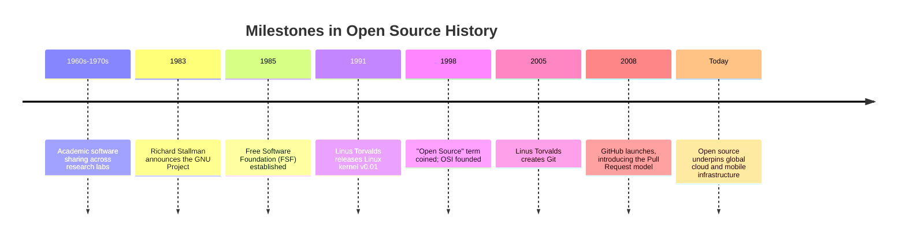

# Lesson 01: History of Open Source

**Goal:** Understand how collaborative software development evolved from early academic traditions into today's global industry standard.
Learn the core milestones, philosophical movements, and tooling breakthroughs that made modern open source possible.

---

## 1. Sharing Code Before "Open Source" (1960s–1980s)

- Early computing operated primarily in university laboratories and corporate research facilities (such as MIT, Stanford, and AT&T Bell Labs).
- Software was not initially sold as an isolated commercial product; it was packaged alongside expensive hardware so scientists could operate machines.
- Researchers and engineers shared source code freely as standard professional practice.
- Code was distributed on paper tape, punch cards, and magnetic tapes through early academic networks and user groups like SHARE and DECUS.
- By the late 1970s and early 1980s, computer manufacturers began treating software as valuable proprietary assets.
- Companies introduced restrictive copyright notices, non-disclosure agreements (NDAs), and binary-only distribution, preventing users from inspecting or modifying program code.

---

## 2. The Free Software Movement

- In 1983, programmer Richard Stallman announced the GNU Project at MIT to create a complete, Unix-compatible operating system made entirely of free software.
- In 1985, Stallman founded the Free Software Foundation (FSF), establishing a legal and philosophical framework centered on user autonomy.
- The movement defined software freedom through four essential freedoms:
  - **Freedom 0:** The freedom to run the program as you wish, for any purpose.
  - **Freedom 1:** The freedom to study how the program works and change it to do your computing as you wish.
  - **Freedom 2:** The freedom to redistribute copies so you can help others.
  - **Freedom 3:** The freedom to distribute copies of your modified versions to others.
- Stallman authored the GNU General Public License (GPL), introducing "copyleft"—a legal mechanism requiring any distributed derivative work to remain free under identical licensing terms.

---

## 3. Linux: Completing the Operating System

- By 1991, the GNU Project had developed essential system tools (including the GCC compiler, Bash shell, and standard C libraries), but lacked a completed, functional kernel.
- In August 1991, Linus Torvalds, a computer science student at the University of Helsinki, announced he was developing a free Unix-like kernel for 386 PCs.
- Torvalds released the Linux kernel under the GNU GPL, inviting developers globally to test and submit patches.
- Combining the Linux kernel with existing GNU tools produced the first completely free, production-ready operating system (often referred to as GNU/Linux).

---

## 4. The Term "Open Source" (1998)

- While Free Software gained technical adoption, commercial enterprises remained skeptical of the term "free", associating it with anti-commercial ideology or lack of financial value.
- In February 1998, Netscape announced it would release the source code for its Communicator web browser.
- A strategy session in Palo Alto, California (attended by figures including Eric Raymond and Bruce Perens) coined the alternative term **"Open Source"**.
- The new framing focused on pragmatic engineering advantages: peer review, security, speed, and collaborative efficiency.
- Raymond and Perens co-founded the Open Source Initiative (OSI) and published the Open Source Definition (OSD), establishing 10 objective criteria for validating licenses.

---

## 5. The Web and GitHub

- Early open source collaboration occurred over email mailing lists and newsgroups using patch files and early version control tools (RCS, CVS, and SVN).
- In 2005, Linus Torvalds created Git to manage the massive distributed collaboration required by the Linux kernel.
- In 2008, GitHub launched, hosting Git repositories behind an intuitive web interface.
- GitHub introduced standardized forks, issue tracking, and browser-based Pull Requests, transforming patch submissions into public, line-by-line discussions.
- Lowering technical barriers enabled millions of developers to discover projects and contribute to codebases globally.

---

## 6. Open Source Today

- Open source software forms the baseline foundation of modern technology, running the majority of web servers, cloud infrastructure, and mobile operating systems.
- Major enterprises (including Google, Microsoft, Meta, Red Hat, and IBM) actively invest billions in open source, employing full-time maintainers and open-sourcing critical frameworks (e.g., Kubernetes, React, Chromium, VS Code).
- Organizations rely on shared open source foundations to reduce development costs, establish open standards, and recruit engineering talent.

---

## 7. Free Software vs Open Source

| Aspect | Free Software | Open Source |
|--------|---------------|-------------|
| **Governing Body** | Free Software Foundation (FSF, 1985) | Open Source Initiative (OSI, 1998) |
| **Primary Focus** | Ethical rights and user freedom | Practical engineering and economic benefits |
| **Core Argument** | Proprietary software restricts user freedom; access to code is a fundamental right | Open collaboration produces higher-quality, more secure software |
| **Typical Phrasing** | "Free as in speech, not free as in beer" | "Given enough eyeballs, all bugs are shallow" |

---

## 8. Historical Timeline

---

## 9. Key Takeaways

- Code sharing was standard academic practice before commercial software restrictions took hold in the 1980s.
- The Free Software movement established the ethical foundations and legal mechanisms of software freedom (GNU and the GPL).
- The Open Source movement created a pragmatic, business-friendly framework that accelerated mainstream commercial adoption.
- Distributed version control (Git) and web-based collaboration platforms (GitHub) democratized participation worldwide.

---

## 10. Sources

- GNU Project — What is Free Software?: https://www.gnu.org/philosophy/free-sw.html
- GNU Project — Overview of the GNU System: https://www.gnu.org/gnu/thegnuproject.html
- Open Source Initiative — History: https://opensource.org/about/history-of-the-open-source-initiative
- Open Source Initiative — The Open Source Definition: https://opensource.org/osd
- The Linux Kernel Archives: https://www.kernel.org/
- GitHub Documentation — What is GitHub?: https://docs.github.com/en/get-started/start-your-journey/what-is-github
