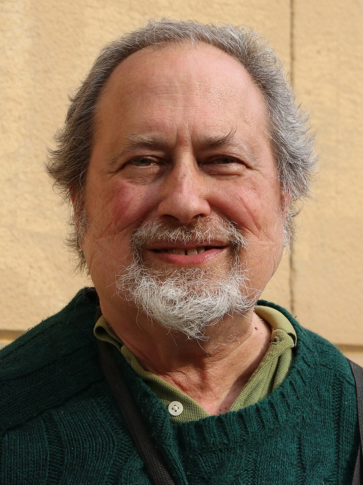

# Section 02: Key People in Open Source

**Goal:** Identify the key figures who shaped the open source movement, their roles, and their enduring contributions to software development.

---

## Key Figures

### Richard Stallman

American programmer and software freedom activist at the MIT Artificial Intelligence Laboratory.
Founder of the Free Software Foundation (FSF) and initiator of the GNU operating system project in 1983.

**Contribution:** Created the GNU General Public License (GPL) and the core GNU developer toolchain.

---

### Linus Torvalds

Finnish software engineer who created the Linux kernel in 1991 as a computer science university student.
Long-time principal coordinator of the Linux kernel project, managing thousands of international contributors.

**Contribution:** Created the Linux operating system kernel and the Git distributed version control system.

---

### Eric Raymond

American software developer, author, and leading advocate for collaborative development methodologies.
Author of the 1997 essay "The Cathedral and the Bazaar", which analyzed the mechanics of open source development.

**Contribution:** Co-founded the Open Source Initiative (OSI) in 1998 and popularized the term "Open Source".

---

### Bruce Perens

American software developer and open source policy strategist.
Former Debian Project Leader who drafted the Debian Free Software Guidelines in 1997.

**Contribution:** Authored the Open Source Definition (OSD), establishing the formal standards for open source licenses.

---

### Tom Preston-Werner

American software developer, entrepreneur, and creator of the Semantic Versioning (SemVer) specification.
Co-founded GitHub in 2008 alongside Chris Wanstrath and PJ Hyett to simplify Git collaboration.

**Contribution:** Co-created GitHub, lowering technical barriers for global distributed collaboration.

---

## Sources

- GNU Project / FSF History: https://www.fsf.org/about
- Linus Torvalds Profile: https://github.com/torvalds
- "The Cathedral and the Bazaar": http://www.catb.org/~esr/writings/cathedral-bazaar/
- Open Source Definition by Bruce Perens: https://opensource.org/osd
- Open Source Initiative History: https://opensource.org/about/history-of-the-open-source-initiative
