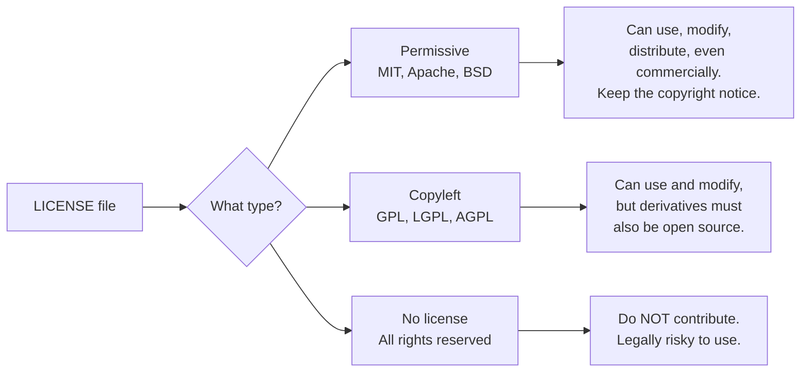
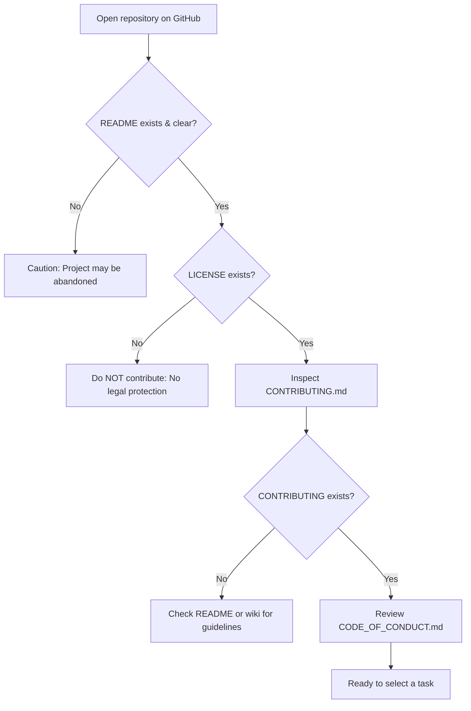

# Section 03: Files Inside an Open Source Repository

**Goal:** Learn what each standard governance file in a repository is for, so you know where to look before you touch any code.

---

## The Standard Repository Files

| File | Purpose | Required? |
|------|---------|-----------|
| `README.md` | What the project is, how to install, and how to use it | Almost always |
| `LICENSE` | Legal terms for using, modifying, and contributing code | Yes for open source |
| `CONTRIBUTING.md` | Guidelines on development setup, code styles, and PR workflows | Very common |
| `CODE_OF_CONDUCT.md` | Standards of behavior expected within the community | Common in active projects |
| `SECURITY.md` | Policy and private contact channel for reporting vulnerabilities | Increasingly common |
| `CHANGELOG.md` | Chronological record of notable changes per version | Common |
| `.github/ISSUE_TEMPLATE/` | Standardized forms for bug reports and feature requests | Common |
| `.github/PULL_REQUEST_TEMPLATE.md` | Checklist and template displayed when opening a PR | Common |

---

## File Details

### README.md

The front page of the project. Read this first.

- What does this project do?
- How do I install it locally?
- How do I run tests?
- Are there status badges indicating build health or test coverage?

A well-maintained README is a primary indicator of a healthy project.

### LICENSE

Defines what you are **legally permitted to do** with the code.

> Rule of thumb: If there is no LICENSE file, default copyright applies and all rights are reserved by the author. The code is not legally open source, regardless of public visibility on GitHub.

### CONTRIBUTING.md

The contributor's manual. Explains development setups, branch conventions, test commands, and Pull Request expectations.

### CODE_OF_CONDUCT.md

Establishes interpersonal behavior standards for community members. Most active projects adopt the Contributor Covenant. It outlines reporting procedures and moderation actions for unacceptable conduct.

### SECURITY.md

Outlines how to report security vulnerabilities privately.

> Never open a public issue for an unpatched security vulnerability. Always use the private reporting channel specified in SECURITY.md.

---

## Inspection Checklist Before You Contribute

---

## Sources

- Choose a License (guide to license selection): https://choosealicense.com
- Contributor Covenant (Code of Conduct standard): https://www.contributor-covenant.org
- GitHub Documentation on Community Profiles: https://docs.github.com/en/communities/setting-up-your-project-for-healthy-contributions
