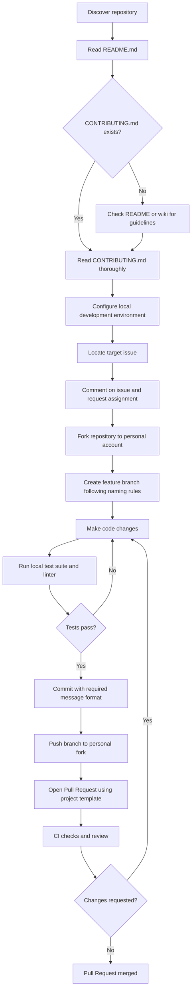

# Section 04: Reading CONTRIBUTING.md

**Goal:** Know how to read and follow a CONTRIBUTING.md file — the rulebook of any open source project.

---

## What Is CONTRIBUTING.md?

A `CONTRIBUTING.md` file is written by project maintainers to tell you:

1. How to configure and run the project locally
2. What coding standards and linters to follow
3. How to write commit messages
4. How tests are run and what coverage is expected
5. How to submit and format a Pull Request

> Skipping this file and opening a PR without reading it often leads to rejection — not because the code is wrong, but because the established process was ignored.

---

## Common Sections in CONTRIBUTING.md

| Section | What It Tells You |
|---------|-------------------|
| **Getting Started / Setup** | How to fork, clone, install dependencies, and run the project |
| **Development Environment** | Supported tools, Node/Python versions, and runtime configurations |
| **Coding Style / Linting** | Formatting rules, linter commands (e.g. ESLint, Prettier, Black) |
| **Commit Message Format** | Required commit conventions (e.g. Conventional Commits) |
| **Branch Naming** | Naming rules for feature branches (e.g. `fix/issue-123`) |
| **Testing** | Commands to run unit and integration tests locally |
| **Pull Request Process** | PR templates, required checklists, and review procedures |
| **Contributor License Agreement (CLA)** | Legal agreements required by some corporate-backed projects |

---

## Real Projects Compared

| Aspect | [VS Code](https://github.com/microsoft/vscode/blob/main/CONTRIBUTING.md) | [React](https://github.com/facebook/react/blob/main/CONTRIBUTING.md) | [freeCodeCamp](https://github.com/freeCodeCamp/freeCodeCamp/blob/main/CONTRIBUTING.md) |
|--------|---------|-------|------------|
| **Setup instructions** | Detailed, step-by-step | Build commands provided | Very detailed, beginner-focused |
| **Commit message style** | Standard team guidelines | Team discretion | Conventional Commits enforced |
| **PR process** | Strict review; CLA required | RFC discussion recommended first | Structured PR template |
| **Testing requirement** | Automated suite required | Unit test suite required | Comprehensive tests required |
| **Beginner-friendliness** | Moderate | Moderate | High (curated first-timers issues) |

---

## From Reading the File to Opening a PR

---

## Key Checkpoints to Note

- **Claiming requirements:** Look for explicit instructions like "comment on the issue before starting work".
- **CLA requirement:** Check whether a digital Contributor License Agreement must be signed before PRs can be merged.
- **Communication channels:** Note if maintainers suggest asking questions in Discord, Slack, or GitHub Discussions.

---

## Sources

- VS Code CONTRIBUTING.md: https://github.com/microsoft/vscode/blob/main/CONTRIBUTING.md
- React CONTRIBUTING.md: https://github.com/facebook/react/blob/main/CONTRIBUTING.md
- freeCodeCamp CONTRIBUTING.md: https://github.com/freeCodeCamp/freeCodeCamp/blob/main/CONTRIBUTING.md
- Conventional Commits Specification: https://www.conventionalcommits.org
