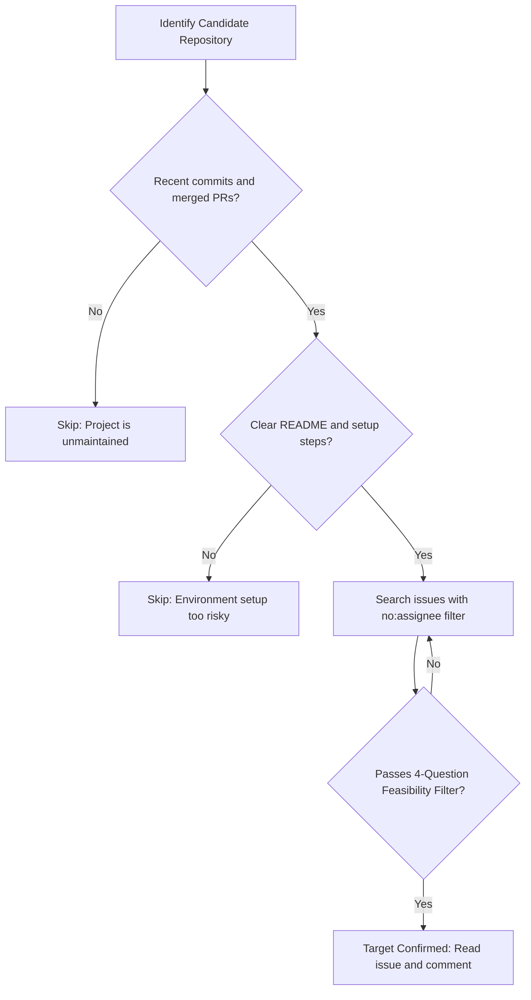

# Section 05: Choosing a Project and Task

**Goal:** Learn how to assess repository health, decode issue labels, and evaluate task feasibility so your first contribution succeeds.

---

## Part 1: Evaluating Project Health

Before searching for tasks, ensure the repository is active and welcoming. Avoid abandoned projects.

| Signal | Healthy Indicator | Warning Sign |
|--------|-------------------|--------------|
| **Last Commit** | Within days or weeks | No commits in 6+ months |
| **Pull Requests** | PRs are regularly reviewed and merged | Hundreds of open PRs with zero maintainer activity |
| **Issue Velocity** | Maintainers triage and respond to issues | Issues sit unanswered indefinitely |
| **Review Tone** | Constructive, welcoming communication | Harsh, dismissive, or hostile replies |
| **Governance** | Clear README, LICENSE, and CONTRIBUTING files | Missing documentation or setup instructions |

---

## Part 2: Decoding Issue Labels

Projects use standard labels to categorize work suitable for newcomers.

| Label | Meaning | Suitability for First PR |
|-------|---------|--------------------------|
| `good first issue` | Curated specifically for newcomers | Ideal starting point |
| `documentation` | Typo fixes, guide updates, translations | Low-risk entry point |
| `help wanted` | Community assistance requested | Check complexity first |
| `beginner-friendly` | Small scope, low architectural depth | Highly recommended |
| `first-timers-only` | Reserved strictly for first-time contributors | Best if available |

---

## Part 3: The 4-Question Feasibility Filter

Do not claim a task solely based on its label. Apply this quick evaluation:

1. **Scope:** Does this task modify only 1 to 3 files?
2. **Reproduction:** Can you reproduce the problem or locate the text locally?
3. **Dependencies:** Can you test the fix without specialized hardware, paid APIs, or complex databases?
4. **Timeframe:** Can you complete and test the change within 2 to 3 days?

If you answer "No" to any of these, look for a smaller task first.

---

## Decision Flowchart



---

## Search Syntax on GitHub

In any repository's Issues tab, use search queries to isolate unclaimed beginner issues:

```text
is:issue is:open label:"good first issue" no:assignee
is:issue is:open label:documentation no:assignee
```

Directories for cross-project discovery:
- **Good First Issue:** https://goodfirstissue.dev
- **Up For Grabs:** https://up-for-grabs.net
- **First Timers Only:** https://www.firsttimersonly.com

---

## Sources

- GitHub Issue Labels Documentation: https://docs.github.com/en/issues/using-labels-and-milestones-to-track-work/managing-labels
- Good First Issue Directory: https://goodfirstissue.dev
- Up For Grabs Community: https://up-for-grabs.net
- Open Source Guides — How to Contribute: https://opensource.guide/how-to-contribute/
