# Section 06: Before You Start and Common Mistakes

**Goal:** Master contribution etiquette, communicate effectively with maintainers, and avoid the most frequent mistakes that lead to rejected Pull Requests.

---

## Part 1: Pre-Code Etiquette and Claiming Issues

Never start coding in silence. Always announce your intention to work on an issue publicly.

### Why Claiming Matters
- **Prevents Duplicate Work:** Stops multiple developers from solving the same problem simultaneously.
- **Validates the Solution:** Maintainers can confirm your proposed approach before you invest hours of effort.
- **Respects the Community:** Demonstrates organizational maturity and collaborative etiquette.

### How to Claim an Issue (Example Comment)
> "Hello! I would like to work on this issue. I reproduced the problem on Node 20 / Linux and traced it to `src/parser.ts`. My plan is to add a null check before calling `tokenize()`. Could you please assign this to me?"

---

## Part 2: Asking Smart Questions

Maintainers are volunteers with limited time. Structure your questions so they are effortless to answer.

| Poor Question | Structured, Smart Question |
|---------------|----------------------------|
| "The build fails, please help." | "Running `npm test` fails with `Cannot find module './config'`. I am on Node v20.10, Ubuntu 22.04, following the setup guide. Here is the full error log: [link]. Did I miss an environment step?" |
| "Where is the authentication code?" | "I reviewed `routes/auth.ts` line 45, but cannot locate where session cookies are signed. Is signing handled in `services/jwt.ts` or middleware?" |
| "Can I fix this?" | "I noticed no activity on this issue for 3 weeks. If it is still open, I would like to take it with the approach discussed above." |

---

## Part 3: Top Beginner Mistakes to Avoid

| # | Mistake | Consequence | Correct Approach |
|---|---------|-------------|------------------|
| 1 | Coding directly on `main` branch | Upstream merge conflicts; blocks future clean syncing | Always create a dedicated branch: `git checkout -b fix/issue-42` |
| 2 | Massive reformatting | An automatic linter reformats 80 files; impossible to review | Edit only lines strictly necessary for your fix; match existing code style |
| 3 | Vague commit messages | Commits named `update`, `fixed`, or `asdf` | Use Conventional Commits: `fix(auth): prevent null token crash` |
| 4 | Ignoring failing CI/CD checks | PR sits with red failing tests; maintainers will not review | Run tests locally before pushing; inspect GitHub Actions logs immediately |
| 5 | Ghosting after review comments | Requested changes sit unattended for weeks | Acknowledge feedback promptly; push updates to the same branch |
| 6 | Unsolicited surprise PRs | 500 lines submitted with no prior issue discussion | Always open or comment on an issue before writing substantial features |

---

## The Lifecycle of a Pull Request

```mermaid
flowchart TD
    subgraph BAD ["The Rejected PR"]
        B1[Code directly on main] --> B2[Format 40 unrelated files]
        B2 --> B3[Commit: 'fixed stuff']
        B3 --> B4[Open PR with empty description]
        B4 --> B5[CI tests fail]
        B5 --> B6[PR closed without merge]
    end

    subgraph GOOD ["The Merged PR"]
        G1[Comment and get assigned] --> G2[Create dedicated branch]
        G2 --> G3[Edit only relevant files]
        G3 --> G4[Pass local tests and linter]
        G4 --> G5[Conventional commit message]
        G5 --> G6[Open PR using project template]
        G6 --> G7[CI passes green]
        G7 --> G8[Maintainer review and merge]
    end
```

---

## Sources

- "How To Ask Questions The Smart Way" by Eric S. Raymond: http://www.catb.org/~esr/faqs/smart-questions.html
- Open Source Guides — How to Contribute: https://opensource.guide/how-to-contribute/
- GitHub Pull Request Documentation: https://docs.github.com/en/pull-requests/collaborating-with-pull-requests/proposing-changes-to-your-work-with-pull-requests/about-pull-requests
