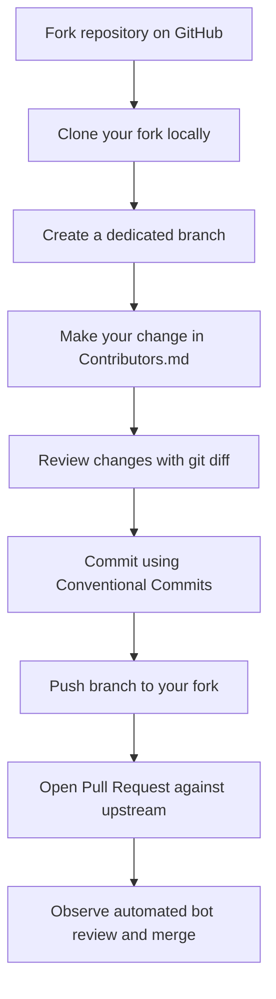

# Section 07: Hands-On Exercise: Your First Pull Request

**Goal:** Complete the full open source contribution lifecycle by creating, testing, and submitting a Pull Request to a live sandbox repository.

---

## Exercise Workflow



---

## Step-by-Step Instructions

This exercise uses `first-contributions/first-contributions`, an open source training project designed specifically for first-time contributors.

### Step 1: Fork the Repository
- Navigate to: `https://github.com/first-contributions/first-contributions`
- Click the **Fork** button (top right) to generate a copy under your personal account.

### Step 2: Clone to Your Local Machine
Open your terminal and run:

```bash
git clone https://github.com/<YOUR-USERNAME>/first-contributions.git
cd first-contributions
```

### Step 3: Create a Dedicated Feature Branch
Never write code directly on `main` or `master`:

```bash
git checkout -b add-<YOUR-USERNAME>
```

### Step 4: Make Your Change
- Open the file `Contributors.md` in your text editor.
- Add your name and GitHub profile link in alphabetical order:
  ```markdown
  [Your Name](https://github.com/<YOUR-USERNAME>)
  ```
- Save the file.

### Step 5: Verify, Commit, and Push

```bash
# Verify only one file was modified
git status

# Inspect the exact lines added
git diff

# Stage and commit with a clean Conventional Commit message
git add Contributors.md
git commit -m "docs: add <YOUR-USERNAME> to contributors list"

# Push the branch to your personal fork
git push -u origin add-<YOUR-USERNAME>
```

### Step 6: Open the Pull Request
- Return to your fork's page on GitHub.
- Click the green **Compare & pull request** button.
- Review your changes in the diff view at the bottom of the page.
- Submit the Pull Request.
- Wait a few seconds for the automated CI bot to validate and merge your PR.

---

## Secondary Exercise: Repository Inspection

If you have already submitted your first PR or prefer inspecting live codebases:

1. Open `https://goodfirstissue.dev`
2. Filter by a language you know (e.g. JavaScript, Python, Go)
3. Locate an active repository with commits within the last 14 days
4. Find their `CONTRIBUTING.md` and identify:
   - Their local test command
   - Their commit message rules
   - Their policy for claiming issues

---

## Sources

- First Contributions Repository: https://github.com/first-contributions/first-contributions
- First Contributions Interactive Guide: https://firstcontributions.github.io
- GitHub Documentation on Pull Requests: https://docs.github.com/en/pull-requests/collaborating-with-pull-requests/proposing-changes-to-your-work-with-pull-requests/creating-a-pull-request
